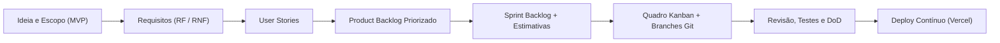

# 📋 Planejamento e Gestão Ágil de Projeto Front-End (Aula 06)

Documento elaborado para atender à **Atividade Prática da Aula 06 (Projetos Front-End)**, estruturando o modelo completo de gestão de tarefas para projetos em grupo da disciplina de **Frameworks Front-end** (SENAI), incluindo **Backlog**, **Prioridades**, **Tarefas**, **Estimativas**, **Sprints**, **Quadro Kanban**, **Estratégia de Branches** e **Critérios de Conclusão (*Definition of Done*)**.

---

## 1. Visão Geral do Processo de Gestão

O fluxo de desenvolvimento combina **Scrum** (organização iterativa por Sprints) e **Kanban** (visualização contínua do trabalho no GitHub Projects), integrado ao controle de versão no **GitHub**.

---

## 2. Estrutura do Quadro Kanban (GitHub Projects)

| Coluna | Finalidade | Regra de Movimentação |
|---|---|---|
| **Backlog** | Funcionalidades e melhorias mapeadas para o produto | Item cadastrado com descrição inicial |
| **Ready** | Itens refinados, priorizados e estimados para a Sprint | Possui User Story, critérios de aceitação e estimativa |
| **In Progress** | Tarefas em desenvolvimento ativo | Branch criada e responsável atribuído |
| **In Review** | Código aguardando revisão por Pull Request | Build local aprovado e PR aberto para `develop` |
| **Done** | Tarefas concluídas e validadas | Todos os itens da *Definition of Done* atendidos |

---

## 3. Escala de Priorização e Estimativa

### Níveis de Prioridade
- 🔴 **Alta (Crítica / MVP):** Indispensável para o fluxo principal funcionar e ser demonstrado.
- 🟡 **Média (Importante):** Melhora a experiência de uso, filtros, feedback visual e navegação complementar.
- 🟢 **Baixa (Desejável):** Refinamentos estéticos ou recursos extras após a estabilização do MVP.

### Estimativa Relativa (Planning Poker — Fibonacci)
- **1 ponto:** Ajuste simples de texto, estilo pontual ou documentação rápida.
- **2 pontos:** Componente estático reutilizável com `props` e estilos responsivos.
- **3 pontos:** Página ou formulário controlado com estado (`useState`) e validações.
- **5 pontos:** Integração assíncrona com API (`fetch` + `useEffect`), tratamento de erro ou fluxo completo entre telas.
- **8 pontos:** Épico grande — deve ser quebrado em tarefas menores antes de entrar na Sprint.

---

## 4. Product Backlog Estruturado (Modelo Base para o Projeto em Grupo)

| ID | Requisito / User Story | Tarefas Técnicas | Prioridade | Estimativa | Sprint |
|---|---|---|---|---:|---:|
| **US01** | Como equipe, queremos estruturar o repositório, rotas e layout base para padronizar o desenvolvimento. | Configurar Vite + React + Tailwind; estruturar pastas `components/`, `pages/`, `services/`; configurar React Router. | 🔴 Alta | 3 pts | Sprint 1 |
| **US02** | Como usuário, quero visualizar uma página inicial clara e responsiva para compreender o objetivo da aplicação. | Criar `Header`, `Sidebar`/`Navbar` mobile e `Footer`; implementar seção principal responsiva. | 🔴 Alta | 3 pts | Sprint 1 |
| **US03** | Como usuário, quero cadastrar registros por meio de um formulário validado para inserir dados na aplicação. | Implementar campos controlados (`value`/`onChange`); validar campos obrigatórios com mensagens claras; tratar `onSubmit` com `preventDefault()`. | 🔴 Alta | 5 pts | Sprint 2 |
| **US04** | Como usuário, quero listar, pesquisar e filtrar registros para encontrar informações rapidamente. | Renderizar coleção com `map()` e `key` única; implementar busca textual e filtro por status/categoria; tratar lista vazia. | 🔴 Alta | 5 pts | Sprint 2 |
| **US05** | Como usuário, quero editar e remover itens cadastrados para manter as informações atualizadas. | Implementar ações de edição e exclusão com confirmação; sincronizar estado ou persistência/API. | 🟡 Média | 5 pts | Sprint 3 |
| **US06** | Como usuário, quero consultar indicadores resumidos em um painel para acompanhar os resultados. | Criar cartões de estatísticas (`StatCard`) reutilizáveis; calcular totais dinamicamente a partir do estado. | 🟡 Média | 3 pts | Sprint 3 |
| **US07** | Como avaliador/usuário, quero acessar a aplicação online em celular ou computador com documentação completa. | Validar responsividade (360px, 768px, 1280px); configurar `vercel.json`; revisar `README.md` e evidências de teste. | 🔴 Alta | 3 pts | Sprint 4 |

---

## 5. Planejamento de Sprints

| Sprint | Foco Principal | Entregável Incrementado |
|---|---|---|
| **Sprint 1** | Planejamento, Prototipação e Arquitetura Base | Escopo MVP definido, quadro Kanban ativo, estrutura React + rotas iniciais |
| **Sprint 2** | Componentes Essenciais, Cadastro e Listagem | Formulários controlados, listagem com `map`/`filter` e estados vazios |
| **Sprint 3** | Edição, Exclusão, Integração de Dados e Dashboard | Fluxo CRUD/interativo completo, tratamento de carregamento e erros |
| **Sprint 4** | Testes de Validação, Responsividade, Deploy e Mini TCC | Aplicação publicada na Vercel, cenários testados e relatório ABNT revisado |

---

## 6. Estratégia de Branches e Padronização de Commits

### Padrão de Branches
- `main`: versão estável e publicada em produção (Vercel), atualizada apenas via Pull Request revisado.
- `develop`: branch de integração contínua das funcionalidades da equipe.
- `feat/<funcionalidade>`: criação de novas telas ou componentes (ex.: `feat/formulario-cadastro`).
- `fix/<correcao>`: correção de defeitos identificados nos testes (ex.: `fix/validacao-campo-vazio`).
- `docs/<documento>`: evolução do `README.md`, backlog ou relatório acadêmico.

### Padrão Conventional Commits
- `feat: implementa componente reutilizavel de card`
- `fix: corrige quebra de layout no menu mobile`
- `docs: documenta cenarios de teste e validacao`
- `refactor: organiza servico de consumo da API`

---

## 7. Critérios de Conclusão — Definition of Done (DoD)

Uma tarefa só pode ser movida para a coluna **Done** quando atender a **todos** os critérios abaixo:

- [ ] Código implementado seguindo a organização de pastas e convenções da equipe;
- [ ] Componentes desacoplados e reutilizáveis sem erros ou avisos críticos no console;
- [ ] Build de produção (`npm run build`) executado com sucesso;
- [ ] Interface responsiva verificada em resoluções mobile (`360px`), tablet (`768px`) e desktop (`1280px`);
- [ ] Estados vazios, mensagens de validação e erros tratados de forma compreensível ao usuário;
- [ ] Pull Request revisado por pelo menos um integrante do grupo e integrado sem conflitos;
- [ ] Documentação correspondente atualizada no repositório.

---

[⬅️ Voltar para a Aula 06](./README.md) | [⬅️ Voltar ao índice principal](../README.md)
